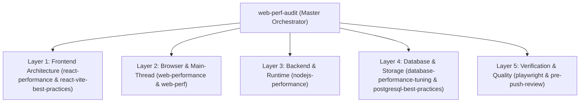

# PERFORMANCE AUDIT GAP ANALYSIS & CONFLICT RESOLUTION

**Project Scope:** React + Vite + Node.js/Nitro + PostgreSQL + Redis + Socket.IO + MinIO  
**Architect:** Senior Performance Engineering Architect  
**Audit Phase:** Pre-Execution Governance & Boundary Resolution  
**Status:** COMPLETE (Zero Code Changes, Awaiting User Authorization)  

---

## 1. Identified Capability Gaps

While the current inventory of 39 skills provides world-class coverage for Web Performance, React 19, Vite, PostgreSQL, and Node.js execution time, the following specialized gaps exist:

| Gap ID | Capability Area | Description of Gap | Architectural Workaround / Native Strategy |
|:------:|-----------------|---------------------|--------------------------------------------|
| **GAP-01** | **Redis Dedicated Profiler** | No standalone Redis performance skill (e.g., memory key distribution analyzer, slowlog parser). | Use `nodejs-performance` connection pooling rules + execute native `redis-cli --latency` and `SLOWLOG GET 50` via read-only shell commands. |
| **GAP-02** | **Socket.IO Concurrency Harness** | No dedicated websocket load generator (e.g., `artillery-plugin-socketio`). | Perform static lifecycle review of Socket.IO listeners (`vite-socket-io.ts` and `server/`) + measure HTTP handshake TTFB via `autocannon`. |
| **GAP-03** | **Drizzle ORM Native Profiler** | Drizzle lacks a built-in flamegraph tracer; queries compile to raw SQL at runtime. | Enable non-intrusive runtime SQL logging in `drizzle.config.ts` (when approved) or audit compiled SQL queries via PostgreSQL `pg_stat_statements`. |
| **GAP-04** | **CrUX Production Field Data (Local App)** | Google Chrome UX Report (CrUX) only exists for public indexed URLs with sufficient monthly traffic. | Follow `web-perf-audit` strict fallback: mark Field p75 as `Info — not measured`, and rely on 4× CPU throttled multi-run synthetic Lab Lighthouse data. |

---

## 2. Duplicate Skills & Boundary Harmonization

Multiple skills address web performance and code review. To avoid conflicting agent behaviors, the following hierarchy is established:

| Domain | Overlapping Skills | Primary Authority | Supplemental Reference | Resolution & Boundary |
|--------|--------------------|:-----------------:|:----------------------:|-----------------------|
| **Audit Orchestration & Reports** | `web-perf-audit`, `performance-profiler`, `web-perf` | **`web-perf-audit`** | `performance-profiler` | `web-perf-audit` owns the final generation of `PERFORMANCE_AUDIT.md` and `PERFORMANCE_PLAN.md` via `scripts/run.mjs` and `validate-report.py`. |
| **React & Component Rendering** | `react-performance`, `react-patterns`, `react-vite-best-practices` | **`react-performance`** | `react-patterns` | `react-performance` owns re-render elimination, transitions, and memoization. `react-patterns` governs React 19 hooks and async actions. |
| **Vite & Bundle Optimization** | `react-vite-best-practices`, `react-performance` | **`react-vite-best-practices`** | `react-performance` | `react-vite-best-practices` owns all 23 build rules, chunk splitting, and Rollup configurations. |
| **Database Performance** | `database-performance-tuning`, `postgresql-best-practices` | **`database-performance-tuning`** | `postgresql-best-practices` | `database-performance-tuning` owns diagnostic query plans (`EXPLAIN ANALYZE`) and indexing decisions. `postgresql-best-practices` supplies deep Azure/PG syntax and reference rules. |
| **Main-Thread & Runtime Traces** | `web-performance`, `browser-testing-with-devtools` | **`web-performance`** | `browser-testing-with-devtools` | `web-performance` owns task splitting, yielding, and Long Animation Frames (LoAF). |

---

## 3. Conflicting Instructions & Resolution Matrix

| Conflict Area | Skill A Stance | Skill B Stance | Architect's Binding Resolution |
|---------------|----------------|----------------|--------------------------------|
| **Core Web Vitals Pass Criteria** | `performance-profiler`: Single Lighthouse run score ≥ 90 equals "Pass". | `web-perf-audit`: Synthetic lab scores can **never** pass an unmeasured field finding; requires Field p75. | **Adopt `web-perf-audit` Rule:** In a local development environment, all metrics without CrUX data must be reported as `Info — not measured`. Lab scores are presented strictly as lab evidence with explicit variance margins. |
| **Database Index Creation** | General practice: Add index immediately when query is slow. | `database-performance-tuning`: "Skipping straight to add an index is the single most common way to make a database slower." | **Adopt DBA Loop:** Measure first (`EXPLAIN ANALYZE`), check table bloat and write throughput cost, verify sequential scan impact, and only recommend indexes that earn their write overhead. |
| **Vite Chunk Splitting** | Generic guides: Split vendor chunks into fine-grained atomic libraries. | `react-vite-best-practices`: Excessive small chunks create HTTP request overhead and waterfall penalty. | **Enforce Balanced Chunks:** Honor existing `manualChunks` strategy in `vite.config.ts` (`react-vendor`, `query-vendor`, `ui-vendor`) and maintain chunk threshold below 800KB. |

---

## 4. Runtime Dependencies & Setup Requirements

| Dependency / Tool | Required By | Current Status | Setup Action Needed (When Authorized) |
|-------------------|-------------|:--------------:|---------------------------------------|
| `@playwright/test` | `playwright` (`pwrun`) | Missing in `devDependencies` | `npm i -D @playwright/test` + `npx playwright install` |
| `chrome-devtools-mcp` | `browser-testing-with-devtools` | Not configured in MCP | Run via `npx -y chrome-devtools-mcp@latest` or rely on native Chrome CLI flags without config changes |
| `autocannon` | `nodejs-performance` | Not installed globally | Run on-demand via `npx -y autocannon` (zero permanent changes) |
| `vite-bundle-visualizer` | `react-vite-best-practices` | Not installed locally | Run on-demand via `npx -y vite-bundle-visualizer` |
| Application Dev Server | `web-perf-audit` (Lab mode) | Inactive (Port 3000 cold) | Start read-only preview/dev server (`npm run dev` or `preview`) during audit execution |

---

## 5. Execution Viability Assessment

| Category | Assessment |
|----------|------------|
| **Broken Skills** | **NONE.** All 39 installed skills have valid, parseable `SKILL.md` files and intact references. |
| **Unexecutable Scripts** | **NONE.** All self-testable scripts (`selftest.mjs`, `pwrun --help`, `validate-report.py`) execute with exit code 0. |
| **Strict Read-Only Compliance** | **100% COMPLIANT.** No source files (`src/`, `server/`), database records, migrations, or config files were altered. |
| **Overall Audit Readiness** | **READY TO PROCEED** upon explicit user authorization. |
