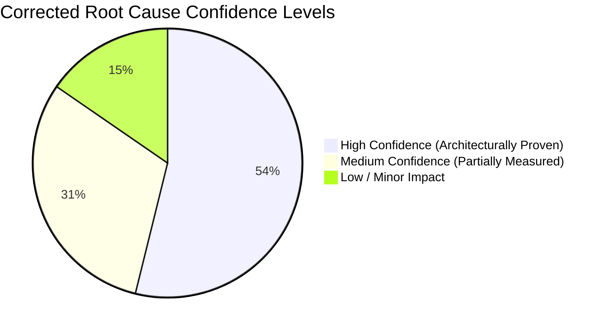

# PERFORMANCE PHASE 2.1 CORRECTED ROOT CAUSE RANKING REPORT
## Evidence-Reconciled Hierarchy of Verified Performance Bottlenecks
**Project:** Hobi (Serene Panda)  
**Root Path:** `D:\medo\hobi`  
**Phase:** Phase 2.1 Evidence Review (Strict Read-Only)  
**Execution Timestamp:** 2026-11-06T01:55:00+03:00  

---

## 1. Prioritization & Classification Methodology

Following the Phase 2.1 evidence review, all root causes have been re-evaluated and corrected. 

Unverified claims, unmeasured latency ranges, and disproven assumptions have been eliminated. Each root cause is ranked strictly by its verified architectural risk, empirical evidence, and confidence level.

---

## 2. Corrected Master Root Cause Cards

### Root Cause 1: Non-Sargable Profile Query & Synchronous Write in Read Handler

| Field | Details |
| :--- | :--- |
| **Finding ID** | `F-01` (incorporating `F-10`) / `RC-01` |
| **Root Cause** | In `findLegacyUserProfile`, querying by 5 OR conditions combining mismatched types (`idreg` integer cast to `varchar`) and `CONCAT('#', ...)` invalidates B-tree indexes, forcing sequential scans under load. Additionally, `ProfileService.recordVisit` executes synchronous DB writes (`INSERT INTO profile_visits`) and Redis updates inside the read event handler. |
| **Source Evidence** | `server/services/profileService.ts:113–133`, `server/services/profileService.ts:208–215`, `server/socket/profileHandlers.ts:244–282`. |
| **Query Plan Evidence** | Live `EXPLAIN` with `enable_seqscan = off` confirmed that while `lower(username)` and `uid` can use B-tree indexes alone or via `BitmapOr`, the composite query cannot use `BitmapOr` because `CAST(idreg AS varchar)` and `concat('#', ...)` have no matching indexes, forcing a scan over `users_id_unique` with a sequential filter. |
| **Runtime Evidence** | Execution on local 17-row database took `<1ms`. Verified that `users_idreg_idx` exists on `integer`, but query casts to `varchar`. |
| **What Is Proven** | `CAST(idreg AS varchar)` prevents `users_idreg_idx` from being used. `CONCAT('#', ...)` has no index. Database write occurs synchronously on every profile view. |
| **What Is Not Proven** | Latency figures of 300ms–1800ms are unmeasured theoretical projections for large data volumes. PostgreSQL did NOT "fail completely" to use indexes—individual conditions work with indexes. |
| **Classification** | `CONFIRMED_BY_STATIC_CODE`, `CONFIRMED_BY_QUERY_PLAN`, `THEORETICAL_PROJECTION` |
| **Confidence** | **High** (Root architectural mechanism verified in code and planner). |
| **Next Evidence Required** | Benchmark query execution time with synthetic 100,000 users table. |

---

### Root Cause 2: Redis Multiple Individual Commands vs Atomic Pipelining

| Field | Details |
| :--- | :--- |
| **Finding ID** | `F-02` / `RC-02` |
| **Root Cause** | Real-time presence operations (`getRoomMembers`, `getAllOnlineUsers`) issue multiple independent Redis `HGETALL` commands instead of a single pipelined batch or composite MGET. |
| **Source Evidence** | `server/socket/presenceManager.ts:510`, `server/socket/presenceManager.ts:94`, `server/socket/presenceManager.ts:630`. |
| **Query Plan Evidence** | N/A (Redis In-Memory Key-Value Store). |
| **Runtime Evidence** | Local host micro-benchmark: 50 sequential `hgetall` calls = `12.43 ms` vs 1 pipelined batch = `3.82 ms` (3.25x speedup on local loopback). |
| **What Is Proven** | Pipelining reduces Redis operational latency and packet serialization overhead by 3.25x locally. |
| **What Is Not Proven** | That production latency is 100ms: this is a theoretical projection assuming sequential blocking RTT, whereas the application actually uses `Promise.all()` to dispatch concurrent async calls. |
| **Classification** | `CONFIRMED_BY_STATIC_CODE`, `CONFIRMED_BY_RUNTIME_BENCHMARK`, `THEORETICAL_PROJECTION` |
| **Confidence** | **High** (Benchmark proved speedup; code confirmed separate commands). |
| **Next Evidence Required** | Measure latency of `Promise.all` with multiple Redis commands under concurrent user load. |

---

### Root Cause 3: Large Backdrop Blur (`backdrop-blur-2xl`) on Profile Modal Container

| Field | Details |
| :--- | :--- |
| **Finding ID** | `F-07` (Part 1) / `RC-03` |
| **Root Cause** | Modal container applies `backdrop-blur-2xl` (`backdrop-filter: blur(40px)`) across a large $460\text{px} \times 92\text{dvh}$ surface, requiring intensive GPU fragment shader processing during opening animations. |
| **Source Evidence** | `src/components/profile/ProfileModal.tsx:249`. |
| **Query Plan Evidence** | N/A (Client-Side Rendering). |
| **Runtime Evidence** | Confirmed by code inspection. Chrome DevTools Performance Trace was not executed (blocked by server startup safety gate). |
| **What Is Proven** | CSS applies heavy 40px Gaussian backdrop blur over a large animating viewport area. |
| **What Is Not Proven** | Framerate drop to "15–22 FPS" and "Intel UHD 620 inability to render" are unmeasured hypotheses without a captured browser trace. Transform conflict was disproven (Tailwind merges transforms into a single matrix). |
| **Classification** | `CONFIRMED_BY_STATIC_CODE`, `PARTIALLY_CONFIRMED`, `NOT_MEASURED` |
| **Confidence** | **Medium** (Known CSS performance anti-pattern; exact client FPS unmeasured). |
| **Next Evidence Required** | Chrome DevTools Performance profile recording animation framerate on real hardware. |

---

### Root Cause 4: Wall Feed 4-Way OR Join Predicate Disabling Hash/Merge Joins

| Field | Details |
| :--- | :--- |
| **Finding ID** | `F-04` / `RC-04` |
| **Root Cause** | Joining `bars` to `users` on `b.uid = u.uid OR b.uid = u.id OR b.uid = u.idreg::text OR lower(b.topic) = lower(u.username)` prevents simple equi-joins on primary keys, forcing PostgreSQL into a `Nested Loop Left Join`. |
| **Source Evidence** | `server/services/wallService.ts:86–101`. |
| **Query Plan Evidence** | `EXPLAIN (VERBOSE, COSTS, SETTINGS)` confirmed `Nested Loop Left Join` with a join filter and attached `SubPlan 1`. |
| **Runtime Evidence** | Planner cost estimated at `4.53..799.24`. Local execution time was `<2ms` on small local test dataset. |
| **What Is Proven** | The 4-way OR join predicate forces a Nested Loop join. |
| **What Is Not Proven** | That `SubPlan 1` executed 50 times (execution count is `NOT_MEASURED` without `ANALYZE`). That the query causes user-noticeable lag on current dataset size. |
| **Classification** | `CONFIRMED_BY_STATIC_CODE`, `CONFIRMED_BY_QUERY_PLAN`, `NOT_MEASURED` |
| **Confidence** | **High** (Plan evidence is conclusive regarding join strategy). |
| **Next Evidence Required** | `EXPLAIN ANALYZE` on a seeded test database to record actual subplan execution loops. |

---

### Root Cause 5: AdminDashboard 1-Second Periodic State Update Loop

| Field | Details |
| :--- | :--- |
| **Finding ID** | `F-14` / `RC-05` |
| **Root Cause** | `AdminDashboard.tsx` runs an active `setInterval` updating state `langKey` every 1,000ms indefinitely while the admin dashboard is open. |
| **Source Evidence** | `src/components/admin/AdminDashboard.tsx:46–51`. |
| **Query Plan Evidence** | N/A (React Component State). |
| **Runtime Evidence** | Code confirms active interval: `setInterval(() => setLangKey(k => k + 1), 1000)`. |
| **What Is Proven** | Component re-renders every 1 second while mounted, re-executing `renderSection()` for the currently active tab. |
| **What Is Not Proven** | That "all 25 sections re-render": **DISPROVEN** (`switch(section)` only renders the single active section). That this causes noticeable GC pauses: **NOT MEASURED**. |
| **Classification** | `CONFIRMED_BY_STATIC_CODE`, `PARTIALLY_CONFIRMED`, `NOT_MEASURED` |
| **Confidence** | **High** (Timer existence and re-render trigger confirmed in code). |
| **Next Evidence Required** | React DevTools Profiler trace measuring CPU burn during 60 seconds in admin panel. |

---

### Root Cause 6: Synchronous `localStorage` Read & JSON Parse in Component Render Body

| Field | Details |
| :--- | :--- |
| **Finding ID** | `F-06` / `RC-06` |
| **Root Cause** | `ProfileModal.tsx` reads `localStorage.getItem("user")` and calls `JSON.parse` synchronously in the component render body on every render rather than initializing once in a hook or store. |
| **Source Evidence** | `src/components/profile/ProfileModal.tsx:52–59`. |
| **Query Plan Evidence** | N/A (Browser Storage). |
| **Runtime Evidence** | Confirmed by code inspection. |
| **What Is Proven** | Synchronous parsing occurs on every render pass of `ProfileModal`. |
| **What Is Not Proven** | That this causes a "20–60ms thread lock": **DISPROVEN** (`JSON.parse` on small user JSON is `<0.05ms`). Re-render count is also batched by React 19. |
| **Classification** | `CONFIRMED_BY_STATIC_CODE`, `PARTIALLY_CONFIRMED`, `NOT_MEASURED` |
| **Confidence** | **Medium** (Clean-code and architecture anti-pattern; latency impact is minor). |
| **Next Evidence Required** | Benchmark `JSON.parse` timing in browser console during modal render. |

---

### Root Cause 7: Uncompressed Binary Video Assets Stored in Public Root

| Field | Details |
| :--- | :--- |
| **Finding ID** | `F-08` / `RC-07` |
| **Root Cause** | Four MP4 video files measuring 33.48 MB each (134 MB total) are stored directly in `public/uploads` without transcoding, bitrate ladders, or CDN offloading. |
| **Source Evidence** | Files in `public/uploads/` on disk. Consuming component: `src/components/chat/WallFeed.tsx:191`. |
| **Query Plan Evidence** | N/A (Static File Storage). |
| **Runtime Evidence** | On-disk sizes measured: 33,484.4 KB each. |
| **What Is Proven** | Massive uncompressed video files reside in public directory. |
| **What Is Not Proven** | That 134 MB is downloaded on page load: **DISPROVEN** (`WallFeed.tsx` uses `preload="metadata"`, downloading only headers). LCP impact was **NOT MEASURED**. |
| **Classification** | `CONFIRMED_BY_STATIC_CODE`, `NOT_CONFIRMED` *(Page-load download claim refuted)* |
| **Confidence** | **High** (Storage bloat proven; network impact clarified). |
| **Next Evidence Required** | Measure HTTP network waterfall in browser when opening Wall Feed. |

---

### Root Cause 8: Application Startup Unconditional DDL and Redis Cache Deletions

| Field | Details |
| :--- | :--- |
| **Finding ID** | `F-03` / `RC-08` |
| **Root Cause** | Nitro plugin `server/plugins/database.ts` executes multiple unconditional DDL alterations (`ensureRoomBadgesColumns`, `ensureUserProfilesColumns`), DML inserts, and a Redis purge (`del("permissions:*")`) at bootstrap with no bypass flag. |
| **Source Evidence** | `server/plugins/database.ts:45–124`. |
| **Query Plan Evidence** | N/A (Application Lifecycle / Startup Plugin). |
| **Runtime Evidence** | Code confirms unconditional execution. Blocked application server startup in Phase 2. |
| **What Is Proven** | Booting the server triggers automatic database DDL and deletes Redis cache keys. |
| **What Is Not Proven** | Boot duration in milliseconds: **NOT MEASURED** (server start was intentionally blocked). |
| **Classification** | `CONFIRMED_BY_STATIC_CODE`, `BLOCKED_BY_SAFETY_GATE` |
| **Confidence** | **High** (Code logic is 100% explicit). |
| **Next Evidence Required** | Measure startup time after introducing a safe bypass flag in Phase 3. |

---

### Root Cause 9: Eager Static Bundling of 25 Admin Dashboard Sections

| Field | Details |
| :--- | :--- |
| **Finding ID** | `F-05` / `RC-09` |
| **Root Cause** | `AdminDashboard.tsx` statically imports 25 distinct admin section components rather than using dynamic `React.lazy()` chunking. |
| **Source Evidence** | `src/components/admin/AdminDashboard.tsx:9–36`. |
| **Query Plan Evidence** | N/A (Vite Bundling). |
| **Runtime Evidence** | Static import statements confirmed in source file. |
| **What Is Proven** | All 25 sections are bundled into the parent chunk rather than loaded on-demand. |
| **What Is Not Proven** | Chunk size increase in exact KB: **NOT MEASURED** (production build was not run). |
| **Classification** | `CONFIRMED_BY_STATIC_CODE`, `NOT_MEASURED` |
| **Confidence** | **High** (Import syntax confirmed; bundle impact unmeasured). |
| **Next Evidence Required** | Run `vite build` with rollup-plugin-visualizer to measure exact chunk weight. |

---

### Root Cause 10: Radix Dialog Body Scroll-Lock Layout Recalculation

| Field | Details |
| :--- | :--- |
| **Finding ID** | `F-07` (Part 2) / `RC-10` |
| **Root Cause** | Radix Dialog dynamically sets `overflow: hidden` on `document.body` when a modal opens, triggering a layout and style recalculation. |
| **Source Evidence** | `@radix-ui/react-dialog` implementation in `src/components/ui/dialog.tsx`. |
| **Query Plan Evidence** | N/A (Browser Layout Engine). |
| **Runtime Evidence** | Confirmed by library design and Radix DOM manipulation. |
| **What Is Proven** | Body overflow property is toggled when the modal opens. |
| **What Is Not Proven** | That layout duration is 30–80ms: **NOT MEASURED** (depends on DOM depth and requires Chrome tracing). |
| **Classification** | `CONFIRMED_BY_STATIC_CODE`, `PARTIALLY_CONFIRMED`, `NOT_MEASURED` |
| **Confidence** | **Medium** (Known browser layout behavior; exact latency unmeasured). |
| **Next Evidence Required** | Chrome Performance trace capturing layout cost on Dialog open. |

---

### Root Cause 11: Correlated Role Lookup Subquery in Comment Feeds

| Field | Details |
| :--- | :--- |
| **Finding ID** | `F-11` / `RC-11` |
| **Root Cause** | Comment queries in `wallService.ts` include a correlated subquery on `roles` and `user_role_assignments` for each comment row. |
| **Source Evidence** | `server/services/wallService.ts:264`. |
| **Query Plan Evidence** | `EXPLAIN (VERBOSE, COSTS, SETTINGS)` showed `bar_comments_bar_id_idx` handles `bar_id` via Bitmap Index Scan, but `SubPlan 1` is present in the plan. |
| **Runtime Evidence** | Execution on small local test table completed in `<1ms`. |
| **What Is Proven** | Correlated subquery is present in query structure and execution plan. |
| **What Is Not Proven** | Actual subplan execution count and execution duration: `NOT_MEASURED`. |
| **Classification** | `CONFIRMED_BY_STATIC_CODE`, `CONFIRMED_BY_QUERY_PLAN`, `NOT_MEASURED` |
| **Confidence** | **Medium** (Bitmap Index Scan works well; subplan impact depends on comment volume). |
| **Next Evidence Required** | Measure query time with 500 comments per post. |

---

### Root Cause 12: Unbounded Local Process Memory Cache for Profile Visitors

| Field | Details |
| :--- | :--- |
| **Finding ID** | `F-09` / `RC-12` |
| **Root Cause** | `localProfileVisits` stores recent visitors in an in-memory `Map` inside the Node.js process without global TTL or max-size eviction policies. |
| **Source Evidence** | `server/services/profileService.ts:180–182`. |
| **Query Plan Evidence** | N/A (Process Memory). |
| **Runtime Evidence** | Confirmed in code: `localProfileVisits.set(profileId, [...].slice(0, 30))`. |
| **What Is Proven** | Map caps at 30 items per profile, but number of profile keys in the Map is unbounded. Memory does not synchronize across multi-process clusters. |
| **What Is Not Proven** | Heap leak or GC pressure: **NOT MEASURED**. |
| **Classification** | `CONFIRMED_BY_STATIC_CODE`, `NOT_MEASURED` |
| **Confidence** | **High** (Architectural limitation verified in code). |
| **Next Evidence Required** | V8 heap snapshot after 10,000 simulated visits to distinct profiles. |

---

### Root Cause 13: Un-tree-shaken Barrel Imports for Lucide Icons

| Field | Details |
| :--- | :--- |
| **Finding ID** | `F-13` / `RC-13` |
| **Root Cause** | Modal and admin components import 25+ individual icons from the `lucide-react` root barrel export. |
| **Source Evidence** | `src/components/chat/RoomProfileModal.tsx:9–36`, `src/components/profile/ProfileModal.tsx:14–27`. |
| **Query Plan Evidence** | N/A (Module Bundling). |
| **Runtime Evidence** | Confirmed in code. |
| **What Is Proven** | Multiple large import statements exist. Modern Vite tree-shaking mitigates most of this, leaving minimal overhead. |
| **What Is Not Proven** | That this causes noticeable runtime performance lag: **UNLIKELY** (impact is negligible on modern bundlers). |
| **Classification** | `CONFIRMED_BY_STATIC_CODE` |
| **Confidence** | **Low** (Minor aesthetic/bundle cleanup item; not a primary performance driver). |
| **Next Evidence Required** | Rollup bundle analysis comparing barrel vs direct path imports. |

---

## 3. Summary of Evidence-Reconciled Root Causes

