# PERFORMANCE PHASE 2.1 FINDING RECONCILIATION REPORT
## Comprehensive Mapping: 14 Static Findings vs 13 Root Causes vs Phase 2.1 Truth
**Project:** Hobi (Serene Panda)  
**Root Path:** `D:\medo\hobi`  
**Phase:** Phase 2.1 Evidence Review (Strict Read-Only)  
**Execution Timestamp:** 2026-11-06T01:50:00+03:00  

---

## 1. Overview & Discrepancy Reconciliation

During Phase 1, **14 static findings** (`F-01` through `F-14`) were documented.  
In Phase 2, a root-cause ranking report created **13 root causes** (`RC-01` through `RC-13`).  

This discrepancy occurred because:
1. **Split Findings:** Static finding `F-07` (Dialog UX & Layout Stutter) was split into two independent root causes: `RC-03` (CSS `backdrop-blur-2xl` & GPU compositing) and `RC-10` (Radix Dialog body scroll-lock reflow).
2. **Omitted / Low-Priority Static Findings:** `F-10` (Socket.IO Timeouts) and `F-12` (Nitro Static Compression) were classified as lower-tier cleanup items and omitted from the top root cause ranking table in Phase 2.
3. **Elevated New Finding:** `F-14` (AdminDashboard 1s interval re-render loop) was discovered during Phase 2 and assigned root cause `RC-05`.

This document reconciles all 14 findings into a unified, traceable matrix with definitive, evidence-backed statuses.

---

## 2. Master Finding Reconciliation Matrix

| Static Finding ID | Phase 2 Root Cause ID | Subsystem | Phase 1 Initial Status | Phase 2 Initial Status | Phase 2.1 Corrected Statuses | Reconciliation Rationale |
| :---: | :---: | :--- | :---: | :--- | :--- | :--- |
| **F-01** | **RC-01** | Database & Sockets | P0 | REVISED_AFTER_RUNTIME_EVIDENCE | `CONFIRMED_BY_STATIC_CODE` `CONFIRMED_BY_QUERY_PLAN` `THEORETICAL_PROJECTION` | Indexes on `uid`, `id`, and `lower(username)` exist and work via `BitmapOr`. Query fails index scan specifically because of `CAST(idreg AS varchar)` (column is integer) and `concat('#', ...)`. The 300–1800ms latency figure is a theoretical projection. |
| **F-02** | **RC-02** | Redis & Sockets | P0 | CONFIRMED_BY_RUNTIME_MEASUREMENT | `CONFIRMED_BY_STATIC_CODE` `CONFIRMED_BY_RUNTIME_BENCHMARK` `THEORETICAL_PROJECTION` | Local benchmark proved pipelining is 3.25x faster (12.43ms vs 3.82ms), but tested an artificial sequential `await` loop. In code, `presenceManager.ts:510` actually uses `Promise.all()`. The 100ms cloud projection is theoretical. |
| **F-03** | **RC-08** | Server Bootstrap | P1 | CONFIRMED_BY_RUNTIME_MEASUREMENT | `CONFIRMED_BY_STATIC_CODE` `BLOCKED_BY_SAFETY_GATE` | Verified in `database.ts:45–124`: 3 unconditional DDL (`ALTER TABLE`), 3 unconditional DML (`INSERT`/`UPSERT`), and 1 Redis purge execute every boot without bypass. Correctly blocked server start. |
| **F-04** | **RC-04** | Database | P1 | CONFIRMED_BY_RUNTIME_MEASUREMENT | `CONFIRMED_BY_STATIC_CODE` `CONFIRMED_BY_QUERY_PLAN` `NOT_MEASURED` | Query plan confirms `Nested Loop Left Join` on 4-way OR predicate. However, `SubPlan 1` execution count (claimed as 50) and runtime duration were NOT measured (EXPLAIN without ANALYZE cannot prove execution counts). |
| **F-05** | **RC-09** | Client Bundle | P1 | CONFIRMED_BY_RUNTIME_MEASUREMENT | `CONFIRMED_BY_STATIC_CODE` | 25 admin sections are statically imported into `AdminDashboard.tsx` without `React.lazy()`. Proven by code inspection. Bundle transfer size unmeasured due to inactive web server. |
| **F-06** | **RC-06** | React Frontend | P1 | CONFIRMED_BY_RUNTIME_MEASUREMENT | `CONFIRMED_BY_STATIC_CODE` `PARTIALLY_CONFIRMED` `NOT_MEASURED` | Synchronous `localStorage.getItem` confirmed in render body. However, React 19 Automatic Batching batches the 5 state updates into 1 render pass. Re-render count and 20–60ms thread lock claims were unmeasured estimates. |
| **F-07** | **RC-03** & **RC-10** | CSS / Layout / GPU | P1 | CONFIRMED_BY_RUNTIME_MEASUREMENT | `CONFIRMED_BY_STATIC_CODE` `PARTIALLY_CONFIRMED` `NOT_CONFIRMED` `NOT_MEASURED` | `backdrop-blur-2xl` confirmed in code; FPS drop is probable but unmeasured. Transform conflict claim is `NOT_CONFIRMED` (CSS merges them). Body scroll-lock reflow is code-proven, but 30–80ms duration was unmeasured. |
| **F-08** | **RC-07** | Media Storage | P1 | CONFIRMED_BY_RUNTIME_MEASUREMENT | `CONFIRMED_BY_STATIC_CODE` `NOT_CONFIRMED` `NOT_MEASURED` | Four 33.5MB MP4 files exist in `public/uploads`. However, `WallFeed.tsx` uses `preload="metadata"` and `loading="lazy"`. The claim that 134MB downloads on page load is `NOT_CONFIRMED` (factually refuted by code). |
| **F-09** | **RC-12** | Node.js Memory | P2 | CONFIRMED_BY_RUNTIME_MEASUREMENT | `CONFIRMED_BY_STATIC_CODE` `NOT_MEASURED` | In-memory `localProfileVisits` Map confirmed in `profileService.ts:181`. Memory growth over time was not measured empirically. |
| **F-10** | *(Merged RC-01)* | Socket.IO Client | P2 | CONFIRMED_BY_RUNTIME_MEASUREMENT | `CONFIRMED_BY_STATIC_CODE` | `ProfileModal.tsx:97` uses fallback `setTimeout(10000)` because socket request lacks native timeout handling. Confirmed in code. |
| **F-11** | **RC-11** | Database | P2 | CONFIRMED_BY_RUNTIME_MEASUREMENT | `CONFIRMED_BY_STATIC_CODE` `CONFIRMED_BY_QUERY_PLAN` `NOT_MEASURED` | Query plan shows `bar_comments_bar_id_idx` works well via Bitmap Index Scan. Correlated `SubPlan 1` is present in plan, but actual execution count is `NOT_MEASURED`. |
| **F-12** | *(Unranked)* | Nitro Server | P2 | BLOCKED_BY_SAFETY_GATE | `CONFIRMED_BY_STATIC_CODE` `BLOCKED_BY_SAFETY_GATE` | Nitro configuration lacks asset compression hooks. HTTP `Content-Encoding` headers could not be verified because server startup was blocked. |
| **F-13** | **RC-13** | Client Bundle | P3 | CONFIRMED_BY_RUNTIME_MEASUREMENT | `CONFIRMED_BY_STATIC_CODE` | 25+ direct Lucide icon imports confirmed across modal components. Minor bundle impact. |
| **F-14** | **RC-05** | React Frontend | P1 | CONFIRMED_BY_RUNTIME_MEASUREMENT | `CONFIRMED_BY_STATIC_CODE` `PARTIALLY_CONFIRMED` `NOT_MEASURED` | `setInterval(..., 1000)` updates state every second, re-rendering `AdminDashboard`. However, claim that "all 25 sections re-render" is FALSE (only active section renders via switch). GC pressure unmeasured. |

---

## 3. Detailed Structural Relationship Analysis

```mermaid
flowchart TD
    subgraph StaticFindings["14 Phase 1 Static Findings"]
        F1["F-01: Profile Query OR Chain"]
        F2["F-02: Room Members Redis N+1"]
        F3["F-03: Startup Auto-Migrations"]
        F4["F-04: Wall Feed OR Join"]
        F5["F-05: 25 Static Admin Imports"]
        F6["F-06: Profile Modal State/Storage"]
        F7["F-07: Dialog Blur & Scroll Lock"]
        F8["F-08: Media Payload Bloat"]
        F9["F-09: In-Memory Caches"]
        F10["F-10: Socket Timeouts"]
        F11["F-11: Wall Comments SubPlan"]
        F12["F-12: Nitro Compression"]
        F13["F-13: Lucide Icon Imports"]
        F14["F-14: Admin 1s Interval Loop"]
    end

    subgraph RootCauses["13 Phase 2 Root Causes"]
        RC1["RC-01: Non-Sargable Profile Query"]
        RC2["RC-02: Redis Sequential Lookups"]
        RC3["RC-03: Backdrop Blur GPU Cost"]
        RC4["RC-04: Wall Quadratic OR Join"]
        RC5["RC-05: Admin 1s Interval Loop"]
        RC6["RC-06: LocalStorage in Render Body"]
        RC7["RC-07: Uncompressed Uploads on Disk"]
        RC8["RC-08: Startup DDL & Redis Flushes"]
        RC9["RC-09: Eager Admin Bundling"]
        RC10["RC-10: Radix Body Scroll Lock Reflow"]
        RC11["RC-11: Comment SubPlan Overheads"]
        RC12["RC-12: Unbounded Local Maps"]
        RC13["RC-13: Lucide Barrel Overhead"]
    end

    F1 --> RC1
    F2 --> RC2
    F3 --> RC8
    F4 --> RC4
    F5 --> RC9
    F6 --> RC6
    F7 --> RC3
    F7 --> RC10
    F8 --> RC7
    F9 --> RC12
    F10 -.->|Merged into Socket Flow| RC1
    F11 --> RC11
    F12 -.->|Lower Tier Cleanup| Clean[Low Priority / Standalone]
    F13 --> RC13
    F14 --> RC5
```

---

## 4. Reconciliation Summary

1. **Total Original Static Findings:** 14
2. **Total Distinct Root Causes:** 13 (derived from splitting F-07 into RC-03 & RC-10, and tracking F-10 & F-12 as secondary architectural items).
3. **Confirmed by Static Code Inspection:** 14 out of 14 code locations verified in source code.
4. **Confirmed by Query Plans:** 3 queries (`findLegacyUserProfile`, `bars` feed, `bar_comments`).
5. **Confirmed by Runtime Benchmarks:** 1 benchmark (Redis pipelining vs sequential execution).
6. **Partially Confirmed:** 4 findings (where code mechanism is proven, but runtime latency or framerate impact was an unmeasured hypothesis).
7. **Refuted / Not Confirmed Assumptions:** 2 specific claims:
   - Claim that 33.5MB videos download on page load (**Refuted: code uses `preload="metadata"`**).
   - Claim that CSS transforms conflict on the compositor (**Refuted: Tailwind merges transform variables into one matrix**).
8. **Theoretical Projections Identified:** 3 major projections (Profile query 300–1800ms, Redis cloud latency 100ms vs 2ms, Radix body lock 30–80ms layout).
9. **Blocked by Safety Gate:** 2 findings (Startup DDL execution and live Nitro HTTP header measurement).
