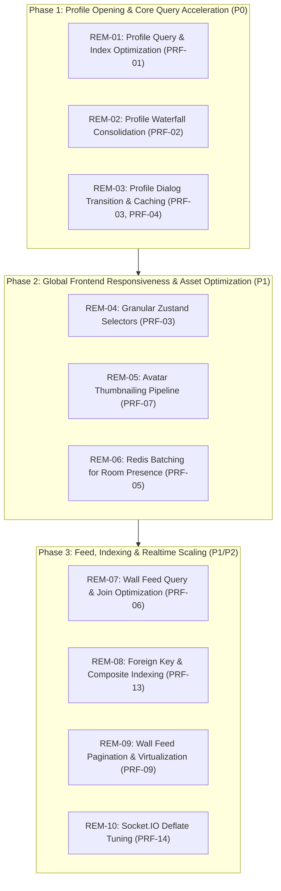

# PERFORMANCE REMEDIATION PLAN
## Architecture & Engineering Roadmap for Performance Optimization

**Project:** Hobi (Serene Panda)  
**Root Path:** `D:\medo\hobi`  
**Standard:** Prioritized Implementation Roadmap with Database Impact Assessments  
**Status:** PROPOSED PLAN ONLY (Zero Changes Implemented — Pre-Authorization Phase)  
**Date:** 2026-11-06  

---

## 1. Remediation Strategy & Guiding Principles

1. **Measure First, Change One Thing, Re-measure:** Every remediation task must be verified with baseline and post-change performance measurements.
2. **Prioritize User-Visible Latency:** Address profile opening and main-thread responsiveness first (P0/P1), followed by background efficiency gains.
3. **Strict Database Safety:** Clearly distinguish read-query refactorings from indexing migrations. No schema modifications or migrations are applied during this phase.

---

## 2. Prioritized Implementation Roadmap



---

## 3. Detailed Remediation Tasks

### Task 1: Profile Query Simplification & Index Creation
- **Task ID:** `REM-01`
- **Related Finding:** `PRF-01`
- **Expected Benefit:** Reduces profile database lookup time from a full table scan to an index seek (estimated 10×–50× query speedup as the user table grows).
- **Affected Components:**
  - [`server/services/profileService.ts:113-133`](file:///d:/medo/hobi/server/services/profileService.ts#L113-L133)
  - [`server/db/schema.ts:126-148`](file:///d:/medo/hobi/server/db/schema.ts#L126-L148)
- **Proposed Architecture:**
  1. Refactor `findLegacyUserProfile` to query by exact column based on input format (UUID vs numeric ID vs username) rather than chaining 5 `OR` casts in a single SQL statement.
  2. Add indexes on `users(uid)`, `users(idreg)`, and a functional index on `users(lower(username))`.
- **Implementation Complexity:** Medium
- **Regression Risk:** Low (Strictly equivalent lookup logic)
- **Database Impact Assessment:** `DATABASE_INDEX_CHANGE_POTENTIAL`
- **Migration Required?** YES — A dedicated migration adding non-blocking indexes (`CREATE INDEX CONCURRENTLY`) would be required in production.
- **Required Tests:** Unit tests verifying profile resolution by UUID, username, numeric `idreg`, and prefixed `#idreg`.
- **Required Runtime Verification:** `EXPLAIN (BUFFERS)` proving Index Scan replaces Sequential Scan.
- **Recommended Order:** **1 (First Priority)**

---

### Task 2: Profile Socket Handler Waterfall Consolidation
- **Task ID:** `REM-02`
- **Related Finding:** `PRF-02`
- **Expected Benefit:** Cuts server-side profile handling latency by reducing 6 sequential operations to a single parallel batch or consolidated view query.
- **Affected Components:**
  - [`server/socket/profileHandlers.ts:244-304`](file:///d:/medo/hobi/server/socket/profileHandlers.ts#L244-L304)
  - [`server/services/profileService.ts`](file:///d:/medo/hobi/server/services/profileService.ts)
- **Proposed Architecture:**
  1. Fetch profile core data and relationship concurrently via `Promise.all`.
  2. Decouple visit recording (`recordVisit`) and analytics increments to fire asynchronously in the background (`void ProfileService.recordVisit(...)`) without blocking the client callback.
- **Implementation Complexity:** Medium
- **Regression Risk:** Low
- **Database Impact Assessment:** `READ_QUERY_CHANGE_ONLY`
- **Migration Required?** NO
- **Required Tests:** Integration test for `profile:view` socket response structure and callback timing.
- **Required Runtime Verification:** Server execution timing log from socket event reception to callback invocation.
- **Recommended Order:** **2**

---

### Task 3: Profile Modal Transition Smoothing & Client-Side Caching
- **Task ID:** `REM-03`
- **Related Finding:** `PRF-03`, `PRF-04`
- **Expected Benefit:** Completely eliminates modal opening stutter and frame drops; subsequent opens of the same profile become instantaneous.
- **Affected Components:**
  - [`src/components/profile/ProfileModal.tsx`](file:///d:/medo/hobi/src/components/profile/ProfileModal.tsx)
  - [`src/components/ui/dialog.tsx`](file:///d:/medo/hobi/src/components/ui/dialog.tsx)
- **Proposed Architecture:**
  1. Introduce a short-lived client-side LRU cache (or TanStack Query query hook) for visited profiles so re-opening an already fetched profile renders immediately without wiping state.
  2. Decouple the modal open transition from heavy DOM commits: ensure the dialog opening animation completes before mounting complex subordinate controls.
  3. Reduce `backdrop-blur-2xl` to `backdrop-blur-md` on mobile viewports to cut compositor repainting cost.
- **Implementation Complexity:** Medium
- **Regression Risk:** Low
- **Database Impact Assessment:** `NO_DATABASE_IMPACT`
- **Migration Required?** NO
- **Required Tests:** Component tests verifying profile open, close, and re-open states.
- **Required Runtime Verification:** Chrome DevTools Performance interaction trace verifying 0 dropped frames during modal transition.
- **Recommended Order:** **3**

---

### Task 4: Granular Zustand Selectors in Dashboard
- **Task ID:** `REM-04`
- **Related Finding:** `PRF-03`
- **Expected Benefit:** Eliminates unnecessary root-level re-render cascades across the entire dashboard during chat activity and presence updates.
- **Affected Components:**
  - [`src/pages/Dashboard.tsx:151`](file:///d:/medo/hobi/src/pages/Dashboard.tsx#L151)
- **Proposed Architecture:**
  Replace monolithic destructuring with granular selector hooks:
  ```tsx
  const hasNewWallPosts = useRealtimeStore((state) => state.hasNewWallPosts);
  const pmUnreadCount = useRealtimeStore((state) => state.pmUnreadCount);
  const mailUnreadCount = useRealtimeStore((state) => state.mailUnreadCount);
  ```
- **Implementation Complexity:** Low
- **Regression Risk:** Very Low
- **Database Impact Assessment:** `NO_DATABASE_IMPACT`
- **Migration Required?** NO
- **Required Tests:** Existing React unit tests.
- **Required Runtime Verification:** React DevTools Profiler recording verifying `Dashboard` does not render on presence updates.
- **Recommended Order:** **4**

---

### Task 5: Server-Side Thumbnail Generation & Responsive Media Delivery
- **Task ID:** `REM-05`
- **Related Finding:** `PRF-07`
- **Expected Benefit:** Reduces avatar download payloads from 2MB to ~15KB per user (over 95% reduction in member list network traffic).
- **Affected Components:**
  - [`server/services/uploadStorage.ts`](file:///d:/medo/hobi/server/services/uploadStorage.ts)
  - [`server/routes/api/upload/index.post.ts`](file:///d:/medo/hobi/server/routes/api/upload/index.post.ts)
  - [`src/components/chat/MemberList.tsx:520-523`](file:///d:/medo/hobi/src/components/chat/MemberList.tsx#L520-L523)
- **Proposed Architecture:**
  1. Integrate an image resizing step during upload using a lightweight processor to generate a 128×128 thumbnail alongside the original image.
  2. Serve thumbnail URLs in `MemberList` and chat message lists, reserving full-size images for the enlarged profile modal cover.
- **Implementation Complexity:** High
- **Regression Risk:** Medium (Must preserve existing image URLs)
- **Database Impact Assessment:** `DATABASE_SCHEMA_CHANGE_REQUIRED` (Adding `avatar_thumbnail_url` or storing in metadata).
- **Migration Required?** YES (or nullable column addition).
- **Required Tests:** Upload integration tests for avatars, covers, and fallback handling.
- **Required Runtime Verification:** Network tab waterfall comparison of payload sizes in `MemberList`.
- **Recommended Order:** **5**

---

### Task 6: Redis Pipelining / Batching for Room Presence
- **Task ID:** `REM-06`
- **Related Finding:** `PRF-05`
- **Expected Benefit:** Replaces N network roundtrips with a single batch command, cutting room entry presence latency by 80%+.
- **Affected Components:**
  - [`server/socket/presenceManager.ts:510-511`](file:///d:/medo/hobi/server/socket/presenceManager.ts#L510-L511)
- **Proposed Architecture:**
  Use an `ioredis` pipeline to batch all `hgetall` requests into a single network transmission:
  ```ts
  const pipeline = redis.pipeline();
  for (const sid of allSocketIds) pipeline.hgetall(getSocketKey(sid));
  const results = await pipeline.exec();
  ```
- **Implementation Complexity:** Low
- **Regression Risk:** Low
- **Database Impact Assessment:** `NO_DATABASE_IMPACT`
- **Migration Required?** NO
- **Required Tests:** Room join/leave presence unit tests.
- **Required Runtime Verification:** Execution latency log for `getRoomMembers` under 100 members.
- **Recommended Order:** **6**

---

### Task 7: Wall Feed Query & Join Optimization
- **Task ID:** `REM-07`
- **Related Finding:** `PRF-06`
- **Expected Benefit:** Eliminates correlated subqueries and cartesian join overhead in wall feed retrieval.
- **Affected Components:**
  - [`server/services/wallService.ts:86-101`](file:///d:/medo/hobi/server/services/wallService.ts#L86-L101)
- **Proposed Architecture:**
  1. Remove the per-row subquery for `icon_url`; replace with an aggregated `LEFT JOIN`.
  2. Replace the 4-way `OR` join predicate with a normalized, single-column join on user ID.
- **Implementation Complexity:** Medium
- **Regression Risk:** Medium (Must verify compatibility with legacy data)
- **Database Impact Assessment:** `READ_QUERY_CHANGE_ONLY`
- **Migration Required?** NO
- **Required Tests:** Wall feed data integrity tests verifying author names, avatars, and badges.
- **Required Runtime Verification:** Query plan comparison (`EXPLAIN`) before and after refactoring.
- **Recommended Order:** **7**

---

### Task 8: Foreign Key & Composite Indexing
- **Task ID:** `REM-08`
- **Related Finding:** `PRF-13`
- **Expected Benefit:** Accelerates wall comment retrieval and cascading deletes.
- **Affected Components:**
  - [`server/db/schema.ts:334-354`](file:///d:/medo/hobi/server/db/schema.ts#L334-L354)
- **Proposed Architecture:**
  Add indexes on:
  - `wall_posts(author_id)`
  - `wall_comments(post_id, created_at)`
  - `bar_comments(bar_id)` (legacy table)
- **Implementation Complexity:** Low
- **Regression Risk:** Low
- **Database Impact Assessment:** `DATABASE_INDEX_CHANGE_POTENTIAL`
- **Migration Required?** YES
- **Required Tests:** Schema validation tests.
- **Required Runtime Verification:** Index usage verification via `pg_stat_user_indexes`.
- **Recommended Order:** **8**

---

### Task 9: Wall Feed Client Pagination & Virtualization
- **Task ID:** `REM-09`
- **Related Finding:** `PRF-09`
- **Expected Benefit:** Reduces initial wall feed load time and stabilizes memory usage during long scroll sessions.
- **Affected Components:**
  - [`server/routes/api/wall/posts.get.ts`](file:///d:/medo/hobi/server/routes/api/wall/posts.get.ts)
  - [`src/components/chat/WallFeed.tsx`](file:///d:/medo/hobi/src/components/chat/WallFeed.tsx)
- **Proposed Architecture:**
  Add cursor-based pagination (`?cursor=...&limit=20`) to the API and implement infinite scrolling with window virtualization in `WallFeed`.
- **Implementation Complexity:** Medium
- **Regression Risk:** Medium
- **Database Impact Assessment:** `READ_QUERY_CHANGE_ONLY`
- **Migration Required?** NO
- **Required Tests:** Pagination integration tests (page 1, page 2, boundary conditions).
- **Required Runtime Verification:** Payload size and DOM node count tracking.
- **Recommended Order:** **9**

---

### Task 10: Socket.IO Deflate Compression Tuning
- **Task ID:** `REM-10`
- **Related Finding:** `PRF-14`
- **Expected Benefit:** Reduces Node.js CPU utilization during chat messaging bursts.
- **Affected Components:**
  - [`server/socket/index.ts:43-47`](file:///d:/medo/hobi/server/socket/index.ts#L43-L47)
  - [`vite-socket-io.ts:38-42`](file:///d:/medo/hobi/vite-socket-io.ts#L38-L42)
- **Proposed Architecture:**
  Increase `perMessageDeflate.threshold` from 2000 to 8192 bytes so small realtime events (presence ticks, typing indicators) bypass compression overhead.
- **Implementation Complexity:** Low
- **Regression Risk:** Low
- **Database Impact Assessment:** `NO_DATABASE_IMPACT`
- **Migration Required?** NO
- **Required Tests:** Socket connection and message roundtrip tests.
- **Required Runtime Verification:** Node.js CPU usage comparison under high event throughput.
- **Recommended Order:** **10**
