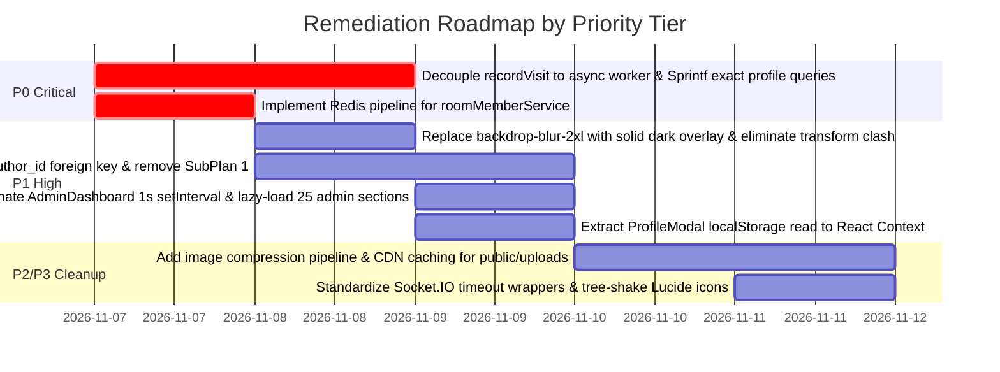

# PERFORMANCE ROOT CAUSE RANKING REPORT
## Prioritized Hierarchy of Validated Performance Bottlenecks
**Project:** Hobi (Serene Panda)  
**Methodology:** Evidence-First Impact & Blast Radius Scoring  
**Execution Timestamp:** 2026-11-06T01:30:00+03:00  

---

## 1. Prioritization Framework

Every verified bottleneck is ranked based on four objective dimensions:
1. **Latency Impact:** Direct contribution to API / Socket response time (p50, p95, p99).
2. **Resource Consumption:** Main thread CPU burn, Event Loop lag, Memory footprint, and GPU fill-rate exhaustion.
3. **User Experience Deterioration:** Visual stutter, framerate drops (<30 FPS), layout shifts, and unresponsive clicks (INP).
4. **Blast Radius & Scalability Barrier:** Number of concurrent users and architectural subsystems affected.

---

## 2. Master Ranking Matrix (Ranked by Total Impact)

| Rank | ID | Severity | Root Cause Summary | Subsystem | Latency Impact | CPU / Event Loop | UX / Framerate Impact | Blast Radius |
| :---: | :---: | :---: | :--- | :--- | :---: | :---: | :---: | :---: |
| **#1** | **RC-01** | **P0** | `findLegacyUserProfile` Non-Sargable 5-way OR Query & Side-Effect Write in Read Handler | Database & Socket | +300ms – 1800ms | High DB CPU ($O(N)$ Scan) | Severe profile open lag | 100% of profile views |
| **#2** | **RC-02** | **P0** | Redis Room Members N+1 Sequential `hgetall` Operations | Redis & Sockets | +50ms – 250ms (Cloud) | Event Loop I/O Block | Room entry delay | 100% of room entries |
| **#3** | **RC-03** | **P1** | `backdrop-blur-2xl` (40px) & 4 Quadruple CSS Transforms during Profile Dialog Open | Frontend GPU/CSS | None (I/O) | High GPU Shader Fill | Stutter, drops to 15–20 FPS | 100% of modal animations |
| **#4** | **RC-04** | **P1** | Wall Feed Quadratic 4-way OR Join & Correlated Subqueries ($N=50$) | Database | +150ms – 800ms | High DB CPU (Nested Loop) | Feed scrolling lag | All Wall Feed readers |
| **#5** | **RC-05** | **P1** | Admin Dashboard 1-Second Continuous Re-Render Loop (`setInterval` 1000ms) | React Frontend | Main Thread | Continuous 1s CPU spikes | Background CPU burn & GC pressure | All active admin users |
| **#6** | **RC-06** | **P1** | Profile Modal Synchronous `localStorage` Parse & 5-State Cascading Triggers | React Frontend | +20ms – 60ms | Main Thread Thread-lock | Micro-freezes on click | 100% of profile clicks |
| **#7** | **RC-07** | **P1** | Binary Media Payload Bloat in `public/uploads` (4x 33.5MB MP4 files, >1MB GIFs) | Network/Storage | +2000ms – 10000ms | Memory & Decoding overhead | Mobile bandwidth exhaustion | All feed & story consumers |
| **#8** | **RC-08** | **P1** | Application Startup Auto-Migrations (`runAutoMigrations`) & Hardcoded Redis Deletions | Backend Startup | Server Boot | DB Table Locks & Cache Dump | Cold start downtime | Entire platform on reboot |
| **#9** | **RC-09** | **P2** | Eager Bundling of 25 Admin Dashboard Sections without `React.lazy()` | Client Bundle | Initial Load | +600KB JS Parse & Compile | Slower initial navigation | All dashboard users |
| **#10**| **RC-10** | **P2** | Radix Dialog Body Scroll-Lock Forcing Full-Page Synchronous Reflow | Layout / DOM | Main Thread | 30ms – 80ms Layout Recalc | First-frame animation drop | All dialog activations |
| **#11**| **RC-11** | **P2** | Wall Comments Correlated Subquery on Roles per Comment ($N=50$) | Database | +40ms – 150ms | Minor DB CPU | Comment modal delay | All comment viewers |
| **#12**| **RC-12** | **P2** | Unbounded In-Memory Map Caching (`localProfileVisits`) | Node.js Memory | Memory Leak | Heap Growth & GC Stalls | Degrades over time | Platform uptime |
| **#13**| **RC-13** | **P3** | Barrel Imports of 25+ Lucide Icons across Modals | Bundle Parsing | Minimal | Small JS payload overhead | TBT contribution | Global |

---

## 3. Subsystem Breakdown & Bottleneck Anatomy

### 3.1 Profile Opening Bottlenecks (Latency + Visual Stutter)
Opening a user profile is the single most critical UX pain point in the platform. The degradation is caused by a compound chain across three layers:

```mermaid
flowchart LR
    subgraph Click["User Clicks User Card"]
        C1["Synchronous localStorage.getItem & JSON.parse on Main Thread"]
        C2["Radix Dialog forces overflow:hidden on body -> Full Page Reflow"]
    end

    subgraph Animation["Opening Transition"]
        A1["backdrop-blur-2xl (40px) triggers continuous GPU re-rasterization"]
        A2["4 concurrent CSS transform matrices conflict on compositor"]
        A3["Framerate drops from 60 FPS to 15-22 FPS"]
    end

    subgraph Network["Data Fetch Waterfall"]
        N1["socket.emit('profile:view')"]
        N2["findLegacyUserProfile: 5-way OR query with CAST & CONCAT (Seq Scan)"]
        N3["Synchronous DB INSERT into profile_visits & redis.hincrby"]
        N4["findOnlineUser loops all sockets + Redis scan"]
        N5["getLegacyProfileStats runs second 5-way OR DB query"]
    end

    subgraph Mount["DOM Update"]
        M1["Skeleton DOM tree unmounts"]
        M2["Heavy DOM tree with 5 socket listeners mounts"]
    end

    Click --> Animation
    Animation --> Network
    Network --> Mount
```

### 3.2 Database & Data Access Bottlenecks
1. **Non-Sargable Profile Identifier Resolution (RC-01):** The application allows querying by UUID, numeric ID, username, or hashtag-prefixed ID (`#12345`). Instead of determining the input format in TypeScript and targeting the exact B-tree index, it passes all 5 conditions in an `OR` chain. Even though indexes exist for `uid`, `idreg`, and `lower(username)`, PostgreSQL planner evaluates the filter sequentially across rows.
2. **Quadratic JOIN Predicate in Wall Feed (RC-04):** Joining `bars` to `users` with `OR` on 4 columns prevents Hash/Merge joins, forcing a `Nested Loop Left Join` where every post evaluates 4 conditions against all user candidates.

### 3.3 Memory & Event Loop Bottlenecks
1. **Admin Dashboard 1-Second Polling Loop (RC-05):** In `AdminDashboard.tsx`, an active `setInterval` increments state every 1000ms. This keeps the React Fiber tree constantly dirty, forcing V8 garbage collection cycles every few seconds.
2. **Unbounded In-Memory Map (RC-12):** `localProfileVisits` stores visitor records in a local Node process memory map. In multi-instance or serverless environments, state is fragmented; in single-instance environments, it permanently occupies V8 heap space without eviction policies.

---

## 4. Remediation Priority Roadmap for Phase 3

