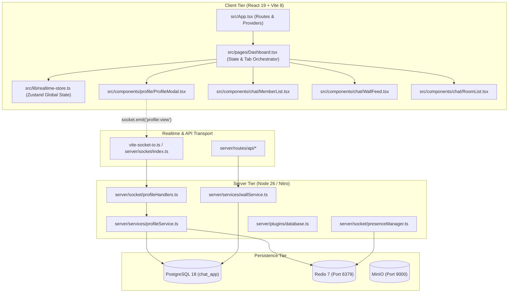

# PHASE 1 — HOBI STATIC PERFORMANCE AUDIT REPORT
## Evidence-First Codebase Performance Investigation

**Project:** Hobi (Serene Panda)  
**Root Path:** `D:\medo\hobi`  
**Stack:** React 19.2 | Vite 8.0 | Node.js 26.1 | Nitro 3.0 | PostgreSQL 18.4 | Drizzle ORM | Redis 7.2 | Socket.IO 4.8 | MinIO  
**Investigation Standard:** Zero-Mutation Static Inspection (`STRICT_READ_ONLY`)  
**Audit Phase:** PHASE 1 — STATIC PERFORMANCE AUDIT  
**Date:** 2026-11-06  

---

## 1. Executive Summary

This static performance audit conducted an exhaustive, evidence-based investigation across the frontend architecture, backend services, database schema, realtime communication layer, caching system, and media pipelines of the Hobi codebase.

### Primary Audit Highlights:
1. **Profile Opening Latency Root Cause (High Priority):**
   The reported sluggishness and animation stutter during profile opening is caused by a multi-tier bottleneck:
   - **Database Tier:** Every profile click triggers an unindexed `SELECT u.*` query with 5 `OR` expressions and runtime `CAST` operations (`CAST(u.uid AS text) = $1 OR ... OR lower(u.username) = lower($1)`), forcing a sequential scan on the `users` table.
   - **Backend Tier:** The `profile:view` socket handler executes a serialized chain of 6–7 database queries and writes before returning the profile payload.
   - **Frontend Tier:** The `ProfileModal` component immediately wipes state, displays a heavy skeleton DOM with `animate-pulse`, and mounts an expensive Radix Dialog with `backdrop-blur-2xl` and 200ms transform animations. When the socket responds, replacing the skeleton with complex subtrees mid-animation induces compositor frame drops.
2. **Global Frontend Re-render Cascades:**
   The root [`src/pages/Dashboard.tsx`](file:///d:/medo/hobi/src/pages/Dashboard.tsx#L151) component subscribes to the entire `useRealtimeStore` without selectors. Every realtime presence tick, member join/leave, or counter change triggers a top-level re-render that cascades into all 5 permanently mounted panels (`MemberList`, `RoomList`, `WallFeed`, `PrivateList`, `NotificationsPanel`).
3. **Database Index Gaps:**
   The `users` table lacks indexes on `uid` and `idreg`, and lacks a functional index on `lower(username)`. Foreign keys in `wall_posts` (`author_id`) and `wall_comments` (`post_id`) lack B-tree indexes, forcing sequential scans during wall feed and comment operations.
4. **Realtime & Redis N+1 Patterns:**
   `getRoomMembers` in [`server/socket/presenceManager.ts`](file:///d:/medo/hobi/server/socket/presenceManager.ts#L510-L511) fires individual `redis.hgetall` calls for every socket in a room, generating an N+1 network roundtrip pattern under high concurrency.
5. **Media Weight Overhead:**
   Avatar and cover uploads are stored and served at full original resolution (up to 2MB–3MB) without server-side thumbnail generation or responsive sizing, causing excessive network payload transfer for 3.7rem UI elements.

---

## 2. Actual Architecture Examined



---

## 3. High-Priority Investigation: Profile Opening Performance

### 3.1 Trace of Complete Execution Path
The end-to-end execution path for opening a user profile was traced from the click event to final render:

1. **User Interaction:**
   - In [`src/components/chat/MemberList.tsx`](file:///d:/medo/hobi/src/components/chat/MemberList.tsx#L507): User clicks a member card: `onClick={() => onOpenProfile?.(member.id)}`.
   - Also triggered from [`WallFeed.tsx`](file:///d:/medo/hobi/src/components/chat/WallFeed.tsx), [`RoomPage.tsx`](file:///d:/medo/hobi/src/components/chat/RoomPage.tsx), and [`PrivateList.tsx`](file:///d:/medo/hobi/src/components/chat/PrivateList.tsx).
2. **Dashboard State Update:**
   - In [`src/pages/Dashboard.tsx`](file:///d:/medo/hobi/src/pages/Dashboard.tsx#L163): `handleOpenProfile` executes `setViewProfileId(uid)`.
   - Dashboard re-renders with `viewProfileId` assigned to the target user ID.
3. **Component Mount & Immediate State Reset:**
   - In [`src/components/profile/ProfileModal.tsx`](file:///d:/medo/hobi/src/components/profile/ProfileModal.tsx#L87-L96): `useEffect` fires immediately:
     ```tsx
     setProfileData(null);
     setStats(null);
     setRelationship({ isSelf: false, isFollowing: false, cooldownRemaining: 0 });
     setVisitors([]);
     setLoading(true);
     ```
   - Previous profile data is completely discarded; **no client-side cache exists**.
4. **UI Skeleton & Animation Trigger:**
   - `ProfileModal` opens `<Dialog open={!!profileId}>`.
   - In [`src/components/ui/dialog.tsx`](file:///d:/medo/hobi/src/components/ui/dialog.tsx#L38-L40), CSS classes trigger entry animations: `data-[state=open]:zoom-in-95`, `slide-in-from-top-[48%]`, `fade-in-0`, with `duration-200`.
   - `DialogContent` in [`ProfileModal.tsx`](file:///d:/medo/hobi/src/components/profile/ProfileModal.tsx#L249) applies heavy styling: `backdrop-blur-2xl`, `shadow-2xl`, `dark:shadow-[0_0_50px_rgba(30,58,138,0.35)]`.
   - Because `profileData === null`, it renders the animated skeleton: `<div className="... animate-pulse">` ([`ProfileModal.tsx:257`](file:///d:/medo/hobi/src/components/profile/ProfileModal.tsx#L257)).
5. **Realtime Network Dispatch:**
   - [`ProfileModal.tsx:104`](file:///d:/medo/hobi/src/components/profile/ProfileModal.tsx#L104): Emits `socket.emit("profile:view", { profileId, hidden: effectiveIsAdmin }, callback)`.
   - Registers 5 socket event listeners inside `useEffect`: `profile:updated`, `user_profile_updated`, `gift_banner_received`, `gift_icon_received`, `gift_promotion_icon_received`.
6. **Backend Socket Handling:**
   - In [`server/socket/profileHandlers.ts:244`](file:///d:/medo/hobi/server/socket/profileHandlers.ts#L244): `socket.on("profile:view")` executes.
   - **Step 6a:** Calls `ProfileService.getFullProfile(requestedProfileId)`.
     - In [`server/services/profileService.ts:113-133`](file:///d:/medo/hobi/server/services/profileService.ts#L113-L133): Executes raw SQL query on `users` with `LEFT JOIN user_profiles`:
       ```sql
       WHERE CAST(u.uid AS text) = $1
          OR CAST(u.id AS text) = $1
          OR CAST(u.idreg AS varchar) = $1
          OR CONCAT('#', CAST(u.idreg AS varchar)) = $1
          OR lower(u.username) = lower($1)
       ```
     - Evaluates 5 `OR` expressions with type casting; triggers a **Sequential Scan on `users`**.
   - **Step 6b:** If not found in DB, calls `await io.fetchSockets()` to scan all cluster sockets in memory ([`profileHandlers.ts:254`](file:///d:/medo/hobi/server/socket/profileHandlers.ts#L254)).
   - **Step 6c:** Calls `ProfileService.recordVisit(userId, resolvedProfileId, isHiddenVisit)`.
     - Calls `addLocalProfileVisit` which re-executes `findLegacyUserProfile(visitorId)` ([`profileService.ts:170`](file:///d:/medo/hobi/server/services/profileService.ts#L170)).
     - Executes `Promise.all([db.query.users.findFirst(...), db.query.users.findFirst(...)])` ([`profileService.ts:195-196`](file:///d:/medo/hobi/server/services/profileService.ts#L195-L196)).
     - Inserts record into `profileVisits` table ([`profileService.ts:208`](file:///d:/medo/hobi/server/services/profileService.ts#L208)).
     - Updates Redis view counter: `redis.client?.hincrby(...)` ([`profileService.ts:215`](file:///d:/medo/hobi/server/services/profileService.ts#L215)).
   - **Step 6d:** Calls `findOnlineUser(resolvedProfileId, profile.username)` ([`profileHandlers.ts:283`](file:///d:/medo/hobi/server/socket/profileHandlers.ts#L283)).
   - **Step 6e:** Calls `ProfileService.getProfileStats(resolvedProfileId)` which queries `users` with another 5 `OR` conditions ([`profileService.ts:145-150`](file:///d:/medo/hobi/server/services/profileService.ts#L145-L150)).
   - **Step 6f:** Calls `ProfileService.getRelationship(userId, resolvedProfileId)` querying `socialEdges` ([`profileHandlers.ts:285`](file:///d:/medo/hobi/server/socket/profileHandlers.ts#L285)).
   - **Step 6g:** Calls `canRunAdminAction(userId, "history")` checking permission caches.
   - **Step 6h:** Emits `profile:viewed` to the target user socket if visitor is different ([`profileHandlers.ts:298`](file:///d:/medo/hobi/server/socket/profileHandlers.ts#L298)).
   - **Step 6i:** Invokes client callback with profile, stats, relationship, and visitor records.
7. **Client State Update & DOM Mutation:**
   - In [`ProfileModal.tsx:108-119`](file:///d:/medo/hobi/src/components/profile/ProfileModal.tsx#L108-L119): Callback receives response; calls:
     ```tsx
     setProfileData(response.profile);
     setStats(response.stats);
     setRelationship(response.relationship);
     setVisitors(response.visitors);
     setLoading(false);
     ```
   - React reconciles state: unmounts skeleton DOM and mounts `ProfileHeader`, `ProfileActions`, `IconPickerPopover`, `LevelShieldBadge`, and multiple image nodes.
   - If the 200ms Radix opening animation is still active when the socket response commits, the browser must calculate layout and repaint the complex blurred background mid-transition, causing visual stutter and noticeable lag.

---

## 4. Frontend Architecture & React Rendering Findings

### 4.1 Global Re-render Cascades from Root State
- **File:** [`src/pages/Dashboard.tsx:151`](file:///d:/medo/hobi/src/pages/Dashboard.tsx#L151)
- **Code Pattern:**
  ```tsx
  const { hasNewWallPosts, setHasNewWallPosts, pmUnreadCount, setPmUnreadCount, mailUnreadCount, resetSession } = useRealtimeStore();
  ```
- **Analysis:** Subscribing to Zustand's `useRealtimeStore` without a selector creates an active subscription to the entire store. Any update to `presence`, `onlineUsers`, `rooms`, `counters`, or `activityFeed` causes `Dashboard` to re-render.
- **Impact:** Re-renders propagate down through all child panels, including the continuously mounted `MemberList`, `RoomList`, `WallFeed`, `PrivateList`, and `NotificationsPanel`.

### 4.2 Simultaneous Mounting of Heavy Chat Panels
- **File:** [`src/pages/Dashboard.tsx:435-508`](file:///d:/medo/hobi/src/pages/Dashboard.tsx#L435-L508)
- **Code Pattern:** Five major tabs (`members`, `rooms`, `wall`, `pm`, `notifications`) are permanently mounted in the DOM using `visibility: hidden` / `contentVisibility: hidden` rather than conditional mounting or route-based code-splitting.
- **Analysis:** Even when idle on the member list, `WallFeed` (1228 lines), `RoomList` (790 lines), `PrivateList` (567 lines), and `NotificationsPanel` maintain active internal hooks, subscriptions, and memory allocations.

### 4.3 Unmemoized Components with Inline Prop Handlers
- **File:** [`src/pages/Dashboard.tsx:458-464`](file:///d:/medo/hobi/src/pages/Dashboard.tsx#L458-L464) and [`src/components/chat/RoomList.tsx:790`](file:///d:/medo/hobi/src/components/chat/RoomList.tsx#L790)
- **Code Pattern:**
  ```tsx
  <RoomList onSelectRoom={(room: any, password?: string) => { ... }} onLockedRoom={(room: any) => { ... }} />
  ```
- **Analysis:** `RoomList` is exported as an unmemoized component (`export default RoomList;`). It receives new arrow function references on every render of `Dashboard`, bypassing any possible memoization.

---

## 5. Navigation & Route Transition Performance

- **File:** [`src/App.tsx:14-20, 47-63`](file:///d:/medo/hobi/src/App.tsx#L14-L20)
- **Architecture:** Pages (`Index`, `Login`, `Dashboard`, `AgentPortal`, `HostingOwnerPortal`) are lazily loaded with `React.lazy` and wrapped in `<Suspense fallback={null}>`.
- **Finding:** While top-level page routes are split cleanly, intra-application navigation inside `/dashboard` relies entirely on internal state switching (`activeTab`) without route-level URL reflection or lazy component boundary encapsulation.

---

## 6. API & Data-Fetching Architecture

### 6.1 Unbounded Wall Posts Query (Missing Client Pagination)
- **File:** [`server/routes/api/wall/posts.get.ts:9`](file:///d:/medo/hobi/server/routes/api/wall/posts.get.ts#L9) and [`server/services/wallService.ts:86-101`](file:///d:/medo/hobi/server/services/wallService.ts#L86-L101)
- **Code Pattern:**
  `const posts = await listWallPosts();`
- **Analysis:** The endpoint accepts no `limit` or `cursor` query parameters from the client. The service hardcodes `LIMIT 50`. The client repeatedly fetches the top 50 posts as a monolithic block, preventing virtualized infinite scrolling.

### 6.2 Correlated Subquery and 4-way OR Join in Wall Feed
- **File:** [`server/services/wallService.ts:87-101`](file:///d:/medo/hobi/server/services/wallService.ts#L87-L101)
- **Code Pattern:**
  ```sql
  SELECT b.id, ...
         (SELECT r.icon_url FROM user_role_assignments ura JOIN roles r ON r.id = ura.role_id AND r.is_active = true WHERE ura.user_id = u.id ORDER BY r.rank DESC LIMIT 1) as "authorRoleIconUrl"
  FROM bars b
  LEFT JOIN users u ON b.uid = u.uid OR b.uid = u.id OR b.uid = u.idreg::text OR lower(b.topic) = lower(u.username)
  LEFT JOIN user_profiles up ON up.user_id = u.id
  ORDER BY b.id DESC
  LIMIT 50
  ```
- **Analysis:**
  1. The correlated subquery inside the `SELECT` clause executes once per row returned from `bars b`.
  2. The `LEFT JOIN` on `users u` contains 4 `OR` conditions across mixed types, preventing PostgreSQL from selecting a hash join or merge join.

---

## 7. PostgreSQL & Drizzle Static Query Audit

### 7.1 Missing Indexes on Core Identification Columns
- **File:** [`server/db/schema.ts:126-148`](file:///d:/medo/hobi/server/db/schema.ts#L126-L148)
- **Code Pattern:**
  ```ts
  export const users = pgTable("users", {
    id: varchar("id", { length: 255 }).primaryKey(),
    legacyId: integer("legacy_id"),
    uid: varchar("uid", { length: 255 }),
    idreg: integer("idreg"),
    username: varchar("username", { length: 64 }).notNull(),
    ...
  }, (table) => [
    uniqueIndex("users_username_idx").on(table.username),
  ]);
  ```
- **Analysis:**
  - `uid` has NO index.
  - `idreg` has NO index.
  - `username` has a standard case-sensitive index, but code queries frequently use `lower(username) = lower($1)`.
  - Queries filtering on `uid` or `idreg` or `lower(username)` cannot utilize B-tree index scans and result in table-wide sequential scans.

### 7.2 Missing Foreign Key Indexes
- **File:** [`server/db/schema.ts:334-348`](file:///d:/medo/hobi/server/db/schema.ts#L334-L348)
- **Analysis:**
  - `wallPosts.authorId` references `users.id` without an index.
  - `wallComments.postId` references `wallPosts.id` without an index.
  - Queries filtering comments by post (`WHERE post_id = $1`) or cascading deletes require full table scans on `wall_comments`.

---

## 8. Backend Node.js & Nitro Architecture

### 8.1 Startup Mutation Hazard (Pre-Audit Blocker)
- **File:** [`server/plugins/database.ts:45-124`](file:///d:/medo/hobi/server/plugins/database.ts#L45-L124)
- **Code Pattern:**
  `const initializeDatabase = async () => { ... await runAutoMigrations(); ... await ensureSiteOwnerAccount(...); await redis.del(...keys); }`
- **Analysis:** Server startup executes automated DDL checks and migrations, creates database records, and flushes cache keys. This prevents launching the backend in a strict read-only audit mode without an explicit dry-run wrapper.

---

## 9. Redis & Caching Architecture

### 9.1 N+1 Redis Network Roundtrips in `getRoomMembers`
- **File:** [`server/socket/presenceManager.ts:510-511`](file:///d:/medo/hobi/server/socket/presenceManager.ts#L510-L511)
- **Code Pattern:**
  ```ts
  const usersPromises = allSocketIds.map((sid) => getConnectedUser(sid));
  const users = (await Promise.all(usersPromises)).filter((u): u is OnlineUser => u !== undefined);
  ```
- **Analysis:** Each `getConnectedUser(sid)` issues an individual `redis.hgetall(getSocketKey(socketId))` command. For a room with 100 members, 100 concurrent Redis commands are fired instead of a pipelined command batch or single Lua evaluation.

### 9.2 Blocking `KEYS` Command in Invalidation Hook
- **File:** [`server/plugins/database.ts:120`](file:///d:/medo/hobi/server/plugins/database.ts#L120)
- **Code Pattern:** `const keys = await redis.keys("permissions:*");`
- **Analysis:** `KEYS` performs a blocking O(N) scan of the entire Redis keyspace, halting all other Redis operations during execution.

---

## 10. MinIO & Media Loading Performance

### 10.1 Full-Resolution Image Delivery Without Thumbnail Generation
- **File:** [`server/services/uploadStorage.ts:15-21`](file:///d:/medo/hobi/server/services/uploadStorage.ts#L15-L21) and [`src/components/chat/MemberList.tsx:520-523`](file:///d:/medo/hobi/src/components/chat/MemberList.tsx#L520-L523)
- **Code Pattern:** Avatar uploads allow up to 2MB; covers allow up to 3MB. No image processing library (e.g., `sharp`) or resizing pipeline is present.
- **Analysis:** Original high-resolution images are served directly from MinIO to the client. The browser must download multi-megabyte payloads for 59px × 59px (`3.7rem`) circular avatars, consuming unnecessary network bandwidth and memory.

---

## 11. Memory & Lifecycle Findings

### 11.1 Lack of Client-Side Profile Caching
- **File:** [`src/components/profile/ProfileModal.tsx:91-95`](file:///d:/medo/hobi/src/components/profile/ProfileModal.tsx#L91-L95)
- **Analysis:** Repeatedly opening the same user profile triggers a complete state wipe and full network roundtrip every single time. There is no short-lived client-side LRU cache or TanStack Query integration for profile views.
